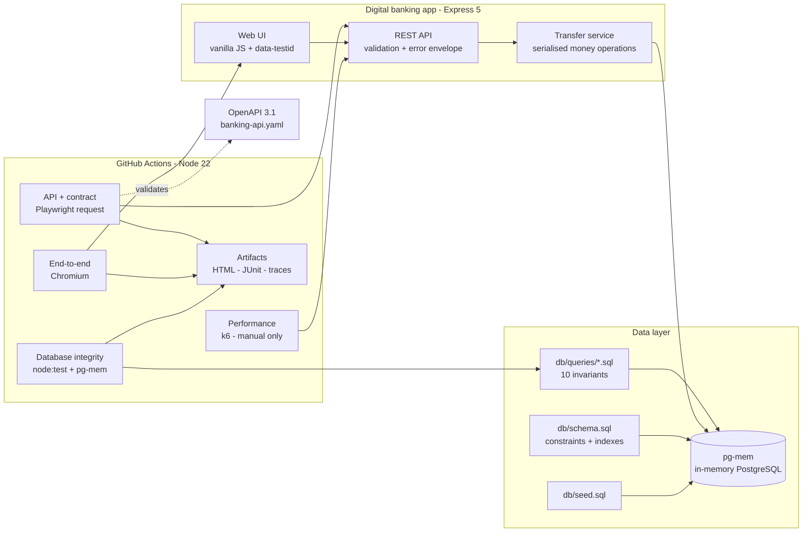

# Digital Banking QA Automation Lab


A production-style QA portfolio project built around a small **digital banking**
system under test: customers, accounts, idempotent transfers and a double-entry
ledger. One repository demonstrates test strategy, API and UI automation, SQL
data-integrity validation, contract testing, performance testing and continuous
testing in GitHub Actions.

> This is a demo. It contains no real customer data, no authentication and no
> external services. All data is in memory and resets when the process restarts.

---

## Overview

The app is an Express 5 service backed by **pg-mem**, a pure-JavaScript PostgreSQL
implementation. The canonical PostgreSQL DDL and seed data live in `db/` and are
executed by both the runtime and the database validation suite, so there is no
Docker database to install for local testing.

Three seeded accounts cover the main scenarios:

| Account | Customer | Currency | Opening balance |
| --- | --- | --- | --- |
| `QA-1001-USD` | Alice Morgan | USD | 1,000.00 |
| `QA-1002-USD` | Ben Okafor | USD | 250.00 |
| `QA-1003-EUR` | Chloe Laurent | EUR | 500.00 |

The web UI at `/` shows account cards, a transfer form and a ledger history view.
Stable `data-testid` attributes keep E2E selectors readable and resilient.

### Core endpoints

| Method | Path | Purpose |
| --- | --- | --- |
| `GET` | `/api/health` | Service and database health |
| `GET` | `/api/accounts` | List accounts with balances |
| `GET` | `/api/accounts/:id` | Account detail |
| `POST` | `/api/transfers` | Idempotent, atomic account-to-account transfer |
| `GET` | `/api/transfers/:id` | Transfer detail |
| `GET` | `/api/accounts/:id/transactions` | Ledger entries with counterparty |
| `POST` | `/api/accounts` | Open an account (used by isolated E2E and load-test setup) |

### Business rules under test

- Amount must be greater than zero, have at most two decimals and not exceed 1,000,000.00.
- Source and destination must exist, be different and be `ACTIVE`.
- Source and destination must share the transfer currency (`USD`, `EUR`, `GBP`).
- The source must have sufficient available funds.
- A repeated idempotency key with an identical payload returns the original transfer
  and must not move money again; a different payload returns `409`.
- A completed transfer writes one `DEBIT` and one `CREDIT` ledger entry and updates
  both balances as one all-or-nothing operation.
- Errors use a stable envelope: `{ "error": { "code", "message", "details?", "requestId" } }`
  with `400`, `404`, `409`, `422` or `500` status codes.

The full contract is in [`openapi/banking-api.yaml`](openapi/banking-api.yaml).

---

## Test architecture



The API project starts a **fresh app and database per test** on an ephemeral port.
The E2E project uses the Playwright web server, but each test creates its own
account pair through the API, so tests are independent and can run in parallel.

---

## Coverage mapped to the QA job description

| Job requirement | How this repository demonstrates it | Evidence |
| --- | --- | --- |
| STLC / SDLC | Strategy, release plan, 36 test cases, traceability, defect workflow and release criteria | `docs/test-strategy.md`, `docs/test-plan.md`, `docs/test-cases.md`, `docs/requirements-traceability-matrix.md` |
| Test strategy, plans and cases | Risk-based strategy, entry/exit criteria, schedule, roles, risk matrix and detailed cases | `docs/` |
| Automation frameworks | Playwright with API and Chromium projects, custom fixtures, deterministic data helpers | `playwright.config.js`, `tests/fixtures/` |
| Functional, integration, system, E2E and regression | API, contract, database and browser suites that can run as a regression pack | `tests/api/`, `tests/e2e/`, `tests/db/` |
| Banking transaction flows and data integrity | Transfers, double-entry ledger, idempotency, reconciliation and orphan checks | `tests/api/transfers.spec.js`, `db/queries/`, `tests/db/integrity.test.js` |
| REST API validation | Positive, negative, boundary, concurrency and error-envelope assertions | `tests/api/transfers.spec.js` |
| SQL / database validation | PostgreSQL DDL, seed, constraints, indexes and 10 invariant queries | `db/`, `scripts/validate-db.js` |
| Defect management | Template plus three realistic defects with severity, root cause and verification | `docs/defect-report-template.md`, `docs/defect-log.md` |
| CI/CD continuous testing | Node 22 workflow, DB -> API -> E2E gates, artifacts, optional performance job | `.github/workflows/ci.yml`, `docs/ci-cd-testing.md` |
| Playwright / Cypress / Selenium | Playwright 1.65 with HTML/JUnit reporters, retries, traces and screenshots | `playwright.config.js` |
| Postman / REST Assured | Equivalent API coverage in Playwright request contexts; OpenAPI importable into Postman | `openapi/banking-api.yaml`, `docs/api-testing.md` |
| JMeter / k6 | k6 load profile with setup, custom success metric and p95/error-rate thresholds | `performance/k6/transfer-load.js`, `performance/README.md` |

---

## Repository map

```text
qa-automation-2026/
+-- app/                     Express API, banking service, web UI, Dockerfile
+-- db/                      PostgreSQL schema, seed and reusable validation SQL
+-- docs/                    Strategy, plan, cases, RTM, defects and test guides
+-- openapi/                 OpenAPI 3.1 contract
+-- performance/             k6 load test and interpretation guide
+-- scripts/                 Database validation runner
+-- tests/
|   +-- api/                 Playwright API and contract suites
|   +-- db/                  node:test database integrity suite
|   +-- e2e/                 Chromium end-to-end suite
|   +-- fixtures/            Isolated server, data and API helpers
+-- .github/workflows/ci.yml Continuous testing pipeline
+-- playwright.config.js
+-- package.json             npm workspace root
```

---

## Quickstart

Requirements: **Node.js 22+** and npm. No database or Docker is required for tests.

```bash
npm install
npx playwright install chromium
npm start
```

Open <http://127.0.0.1:3000>. In another terminal:

```bash
npm test
```

On Linux CI or a fresh machine, install browser dependencies with:

```bash
npx playwright install --with-deps chromium
```

### Test commands

| Command | What runs | Typical count |
| --- | --- | --- |
| `npm run test:db` | `node:test` + pg-mem integrity suite | 10 tests |
| `npm run test:api` | Playwright `api` project: accounts, health, transfers, OpenAPI contract | 30 tests |
| `npm run test:e2e` | Playwright `e2e` project: Chromium UI flows | 5 tests |
| `npm test` | DB -> API -> E2E, the same order as CI | 45 tests |
| `npm run validate:db` | Standalone SQL invariant runner with a demo transfer | 10 checks |
| `npm run report` | Opens the last Playwright HTML report | - |

Run a single project or test file:

```bash
npx playwright test --project=api
npx playwright test tests/api/transfers.spec.js --grep "idempotent"
npx playwright test --project=e2e --headed
```

The Playwright web server listens on `127.0.0.1:3100` by default. Override it with
`BASE_URL`, for example:

```bash
BASE_URL=http://127.0.0.1:3000 npm run test:e2e
```

On PowerShell: `$env:BASE_URL='http://127.0.0.1:3000'; npm run test:e2e`.

### Performance

```bash
npm start
k6 run performance/k6/transfer-load.js
```

See [`performance/README.md`](performance/README.md) for Docker usage, thresholds
and result interpretation. Performance is a manual CI job, not a pull-request gate.

---

## How to read the reports

After a Playwright run:

- **HTML report** - `playwright-report/index.html`, or `npm run report`.
- **JUnit XML** - `test-results/junit.xml`, suitable for CI dashboards.
- **Failure artifacts** - `test-results/artifacts/` contains traces on first retry,
  screenshots on failure and retained videos.
- **Console output** - the `list` reporter shows each test and failure diff.

A trace is the fastest way to debug an E2E failure:

```bash
npx playwright show-trace test-results/artifacts/<test-folder>/trace.zip
```

Database validation prints one line per invariant. Any `FAIL` line includes the
offending rows as JSON. The same queries are used by `tests/db/integrity.test.js`.

---

## Continuous integration

`.github/workflows/ci.yml` runs on push, pull request and manual dispatch:

1. Checkout, Node 22 with npm cache, `npm ci`.
2. Install Chromium with system dependencies.
3. `npm run test:db`.
4. `npm run test:api`.
5. `npm run test:e2e`.
6. Upload `playwright-report/` and `test-results/junit.xml` **always**.

The optional `performance` job only runs on `workflow_dispatch`. It starts the app,
waits for `/api/health`, runs k6 in Docker against the local service and uploads the
summary. No secrets, services or external databases are required.

See [`docs/ci-cd-testing.md`](docs/ci-cd-testing.md) for branch protection, flake
policy and extension notes.

---

## Docker

Build from the repository root so the Dockerfile can copy the workspace manifest,
app and database SQL:

```bash
docker build -f app/Dockerfile -t banking-qa-lab .
docker run --rm -p 3000:3000 banking-qa-lab
```

Then open <http://127.0.0.1:3000>. The image runs as the non-root `node` user and
has a container health check against `/api/health`.

> `app/.dockerignore` documents app-local build exclusions. The effective build
> context for the command above is the repository root, so the root `.dockerignore`
> is the one Docker applies.

---

## Design notes and caveats

- **Money is a decimal string** (`"125.50"`) in API responses. Requests accept a
  JSON number or a decimal string; the API normalises to cents before writing.
- **Atomicity without a real database transaction.** pg-mem's pg adapter executes
  each statement in its own implicit transaction, so `BEGIN`/`COMMIT` cannot span
  awaited statements. The app serialises all money operations and uses a pg-mem
  restore point to roll back partial writes. A production PostgreSQL implementation
  would use `BEGIN`, `SELECT ... FOR UPDATE` row locks and `COMMIT`; this trade-off
  is documented in [`docs/database-validation.md`](docs/database-validation.md).
- **Test isolation over shared state.** API tests each get a fresh server/database.
  E2E tests create dedicated account pairs through the API instead of mutating seed
  balances, so retries and parallel workers stay deterministic.
- **No authentication, rate limiting or PII.** The lab is intentionally narrow.
  Security testing is represented by input validation and error-envelope cases,
  not by a production auth model.
- **pg-mem is a test double.** The SQL is standard PostgreSQL and the schema is
  validated by constraints, but pg-mem is not a production database. The DB suite
  is designed to catch logical drift, not PostgreSQL planner behaviour.
- **k6 results are lab results.** Shared CI runners and the in-memory database make
  absolute numbers non-production; the thresholds prove the pipeline can enforce
  a performance budget.

---

## Documentation

| Document | Purpose |
| --- | --- |
| [`docs/test-strategy.md`](docs/test-strategy.md) | Scope, risks, levels, environments, entry/exit and defect workflow |
| [`docs/test-plan.md`](docs/test-plan.md) | Release 2026.1 schedule, roles, deliverables and risk matrix |
| [`docs/test-cases.md`](docs/test-cases.md) | 36 detailed cases with priority, type, automation and traceability |
| [`docs/requirements-traceability-matrix.md`](docs/requirements-traceability-matrix.md) | Requirement -> test -> automation mapping |
| [`docs/api-testing.md`](docs/api-testing.md) | API strategy, isolation, idempotency and error matrix |
| [`docs/database-validation.md`](docs/database-validation.md) | Schema, invariants, pg-mem trade-offs and production mapping |
| [`docs/ci-cd-testing.md`](docs/ci-cd-testing.md) | Pipeline stages, artifacts, flake policy and branch protection |
| [`docs/defect-report-template.md`](docs/defect-report-template.md) | Reusable defect report structure |
| [`docs/defect-log.md`](docs/defect-log.md) | Three sample defects with root cause and verification |

---

## License

MIT - see [`LICENSE`](LICENSE). The demo is provided for portfolio and educational
use and is not affiliated with any real bank.
