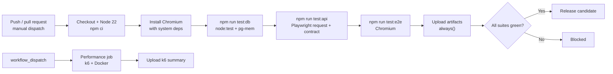

# CI/CD Continuous Testing Guide

The pipeline is the release gate. It runs the same commands a developer runs
locally, in the same order, and publishes evidence even when a suite fails.

## 1. Pipeline overview



## 2. Workflow stages

| Stage | Command | Purpose | Typical duration |
| --- | --- | --- | --- |
| Install | `npm ci` | Reproducible dependency install from the lockfile | ~30 s |
| Browser | `npx playwright install --with-deps chromium` | Chromium plus Linux libraries | ~60 s |
| Database | `npm run test:db` | Schema, constraints and ten invariants | ~5 s |
| API | `npm run test:api` | Business rules and OpenAPI contract | ~30 s |
| E2E | `npm run test:e2e` | Customer journey in Chromium | ~30 s |
| Artifacts | `actions/upload-artifact` | HTML report, JUnit, traces | ~10 s |

The suites run sequentially because they share the same working tree and the API and
E2E projects write to the same `playwright-report/` directory. A failure stops the
job so the next stage does not produce misleading output, but the artifact step uses
`if: always()` so partial evidence is still available.

## 3. Artifacts

| Artifact | Path | Retention | Use |
| --- | --- | --- | --- |
| `playwright-report` | `playwright-report/` | 14 days | Human-readable HTML report |
| `playwright-junit` | `test-results/junit.xml` | 14 days | CI dashboards and trend data |
| `test-artifacts` | `test-results/artifacts/` | 14 days | Traces, screenshots, videos |
| `k6-summary` | `performance/k6/summary.json` | 14 days | Performance evidence (manual job) |

The HTML report is a single self-contained directory; download the artifact and open
`index.html`. Traces open with `npx playwright show-trace <trace.zip>`.

## 4. Triggers and concurrency

| Trigger | Behaviour |
| --- | --- |
| `push` to `main` | Full gate |
| `pull_request` to `main` | Full gate |
| `workflow_dispatch` | Full gate plus the optional performance job |

Concurrency is keyed by workflow and ref with `cancel-in-progress: true`. Pushing a
fix to a pull request cancels the previous run instead of queueing obsolete work.

## 5. Failure policy

| Failure | Action |
| --- | --- |
| Database invariant | Block release. Inspect the offending rows printed by the runner. |
| API functional or contract | Block release. Use the request id and JUnit failure message. |
| E2E | Download the trace and screenshot; determine product defect vs. flake. |
| Performance threshold (manual) | Investigate; record the result and decision. Not a PR gate. |
| Infrastructure (runner, browser install) | Retry the job once, then escalate as an environment incident. |

A red pipeline is never "fixed" by disabling a test. If a test is wrong, correct it
in the same pull request that changes the behaviour; if the product is wrong, file a
defect using [`defect-report-template.md`](defect-report-template.md).

## 6. Flake policy

- Playwright retries are **2 in CI** and **0 locally**. Local runs must be honest.
- `trace: 'on-first-retry'` captures the first retry, which is usually enough to
  diagnose a race without storing a trace for every green test.
- A test that retries more than once per week is quarantined with an owner and a
  defect id. Quarantine is time-boxed, not permanent.
- No `waitForTimeout`, no fixed sleeps, no retry loops inside a test.
- Order dependence is treated as a defect: API tests get a fresh database and E2E
  tests create their own accounts.

## 7. Branch protection

Recommended settings for `main`:

- Require the CI workflow to pass before merging.
- Require at least one review.
- Require branches to be up to date before merging.
- Dismiss stale approvals on new commits.
- Block force pushes and deletions.
- Do not allow bypass for administrators, except for documented incidents.

The performance job is manual, so it is not a required status check. A release owner
records the latest performance evidence in the release note.

## 8. Extending the pipeline

| Need | Change |
| --- | --- |
| Real PostgreSQL | Add a `services: postgres:16` block, point `DATABASE_URL` at it, and run the same schema/seed and DB suite. |
| Parallel Playwright projects | Split `test:api` and `test:e2e` into separate jobs and merge reports with `blob` reporters. |
| Cross-browser | Add `firefox`/`webkit` projects and install those browsers; expect a longer runtime. |
| Scheduled regression | Add a `schedule` trigger (for example nightly) running the full pack. |
| Performance gate | Promote the k6 job to `pull_request` only after the runner is stable enough for meaningful thresholds. |
| Coverage | Add `c8` for the Node app and publish an lcov artifact. |
| Security | Add `npm audit --audit-level=high` and a dependency review action. |

## 9. Local parity

The CI commands are intentionally the same as the documented local commands:

```bash
npm ci
npx playwright install --with-deps chromium
npm run test:db
npm run test:api
npm run test:e2e
```

If a test passes locally but fails in CI, check the Node version, the browser
install step, the working directory and the presence of a stale `test-results/`
directory. The pipeline does not use secrets, external services or a database
server, so environment drift is limited to the runner image and browser version.

## 10. Limitations

- No deployment stage: this is a portfolio lab, not a production release pipeline.
- No container registry or image scanning.
- No test-impact analysis; every change runs the full pack, which is affordable at
  this size.
- The performance job runs against a single in-memory process and is not a capacity
  certification.
