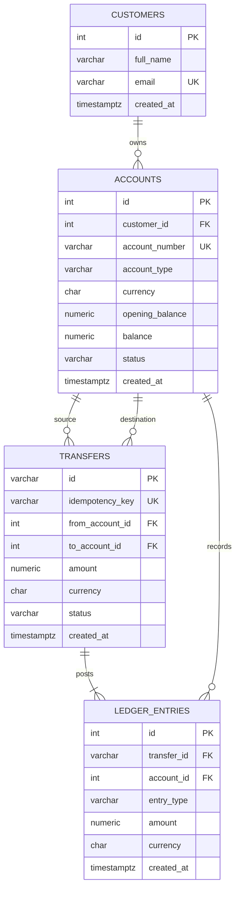

# Database Validation Guide

The database suite proves that the transfer service leaves the ledger in a state an
auditor can explain: every debit has a credit, every balance reconciles to its opening
balance and history, and constraints block the most dangerous invalid states.

## 1. Data model



### Constraints and indexes

| Table | Guardrails |
| --- | --- |
| `customers` | Unique email, non-null name |
| `accounts` | Unique account number, customer FK, valid type/currency/status, opening and current balance >= 0 |
| `transfers` | UUID primary key, unique idempotency key, source/destination FKs, amount > 0, distinct accounts, valid currency/status |
| `ledger_entries` | Transfer FK, account FK, `DEBIT`/`CREDIT` only, amount > 0, valid currency |

Indexes cover the account customer, transfer source/destination/date and ledger
account/transfer lookups used by history and reconciliation queries.

The canonical files are [`db/schema.sql`](../db/schema.sql) and
[`db/seed.sql`](../db/seed.sql). The app and the DB tests both execute these exact
files, so a schema change cannot silently bypass the validation suite.

## 2. Invariants

Each query returns **zero rows** in a healthy database. A returned row is a
violation with enough columns to diagnose it.

| Invariant | Query | What a violation means |
| --- | --- | --- |
| Debits and credits net to zero per transfer | `ledger-net-zero.sql` | The ledger does not balance for that transfer |
| Balance = opening + credits - debits | `account-balance-reconciliation.sql` | The account balance and ledger disagree |
| No orphan ledger entries | `orphan-ledger-entries.sql` | A ledger row points at a missing transfer or account |
| Idempotency keys are unique | `duplicate-idempotency-keys.sql` | The same key was stored twice |
| Transfer amounts are positive | `non-positive-transfer-amounts.sql` | A zero or negative transfer exists |
| Exactly one debit and one credit per transfer | `transfer-entry-pairing.sql` | Missing, extra or duplicated entries |
| Ledger rows match transfer amount, currency and side | `ledger-consistency.sql` | Wrong amount, currency or account side |
| No negative account balances | `negative-account-balances.sql` | Funds check or constraint was bypassed |
| No self-transfers | `self-transfers.sql` | Source and destination are the same account |
| Ledger types and amounts are valid | `invalid-ledger-entries.sql` | Invalid entry type or non-positive ledger amount |

The manifest in [`db/queries/manifest.js`](../db/queries/manifest.js) is the single
source of truth used by both the test suite and the CLI runner.

## 3. Test suite

[`tests/db/integrity.test.js`](../tests/db/integrity.test.js) uses `node:test` and
pg-mem. It covers both healthy and deliberately broken fixtures:

1. Seed data passes all ten invariants.
2. A balanced 100.25 transfer updates both balances and still passes.
3. A debit-only transfer is detected by net-zero, pairing and reconciliation.
4. Balanced ledger rows with stale balances are detected by reconciliation.
5. Foreign keys reject orphan ledger entries.
6. Unique constraints reject duplicate idempotency keys.
7. Check constraints reject zero, negative and self-transfers.
8. Check constraints reject invalid ledger types, amounts and currencies.
9. Missing and duplicate ledger entries are detected by pairing.
10. The manifest covers every required invariant.

The suite does not merely assert that "bad inserts fail"; it also inserts structurally
valid but semantically wrong data (unbalanced or stale) to prove the validation
queries actually catch drift.

## 4. Running the validation

```bash
# Automated suite
npm run test:db

# Standalone report with a demo transfer
npm run validate:db
```

The runner applies schema and seed, inserts one balanced 125.50 transfer, executes
all ten queries and prints one line per invariant. It exits with code 1 if any query
returns a violation, which makes it usable as a release gate.

```text
[PASS] ledger-net-zero                   0 violation(s)
[PASS] account-balance-reconciliation    0 violation(s)
...
Database validation passed: 10 invariants, 0 violations.
```

When a query fails, the offending rows are printed as JSON. Start with the transfer
id or account id, then compare the transfer, its two ledger entries and both account
balances.

## 5. pg-mem and the transaction trade-off

pg-mem gives the project a zero-install PostgreSQL-compatible database, but its pg
adapter executes each statement in its own implicit transaction. A `BEGIN` sent in
one query does not cover the next awaited query, so a naive
`BEGIN -> debit -> credit -> ledger -> COMMIT` can leave partial state on failure.

The demo handles this explicitly:

- **Serialisation:** all money operations, including account reads used for
  validation, pass through one in-process queue. No reader sees a half-applied
  transfer.
- **Restore point:** before the write sequence, the service takes `db.backup()`. If
  any step throws, `backup.restore()` returns the database to the pre-transfer state.
- **Database backstop:** the unique idempotency constraint and balance checks remain
  in the schema.
- **Documentation:** the production mapping is stated rather than hidden.

| Demo (pg-mem) | Production PostgreSQL |
| --- | --- |
| In-process serial queue | `BEGIN` + `SELECT ... FOR UPDATE` on both accounts, or serializable isolation |
| `db.backup()` / `restore()` | `ROLLBACK` |
| Single process | Connection pool, retry on serialization failure, distributed idempotency |
| In-memory, resets on restart | Durable storage, backups, point-in-time recovery |
| Unique idempotency constraint | Same, plus a request/response audit table if required |

This is a deliberate lab trade-off, not a claim that a JavaScript restore point is a
production transaction manager.

## 6. Production mapping

If this schema were moved to PostgreSQL:

1. Keep the constraints and indexes; they encode important business invariants.
2. Replace the restore point with a real transaction and row locks on the source and
   destination accounts. Lock in a deterministic order to avoid deadlocks.
3. Keep the unique idempotency key and return the stored transfer on conflict.
4. Use `NUMERIC(14,2)` end to end; never use floating point for money.
5. Add an append-only audit table for transfer state changes and actor identity.
6. Add a reconciliation job that runs the same queries on a schedule and alerts on
   non-zero rows.
7. Add migrations and version the schema; the demo applies the schema directly.

## 7. Adding an invariant

1. Add the SQL file under `db/queries/` and make it return zero rows when healthy.
2. Add an entry to `db/queries/manifest.js`.
3. Add a healthy and a deliberately broken fixture to the node:test suite.
4. Run `npm run test:db` and `npm run validate:db`.
5. Update the invariants table and, if the invariant maps to a requirement, the RTM.

Keep validation queries read-only. They are run against seeded and demo data and
must never mutate the database.

## 8. Known limitations

- pg-mem implements a subset of PostgreSQL; planner, locking and some SQL functions
  are not exercised. The queries use portable SQL and derived tables.
- The demo has no migrations, partitioning, archival or encryption at rest.
- No concurrent multi-process writer is tested; the in-process queue is the demo
  guarantee and the unique constraint is the backstop.
- The schema supports `FROZEN` and `CLOSED` accounts, but the seed only contains
  active accounts. The API checks status and has a 409 path; a dedicated frozen-account
  fixture would strengthen coverage in a production version.
